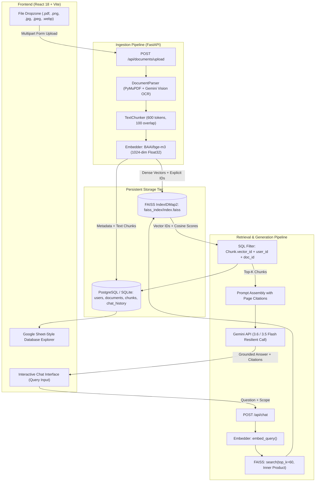
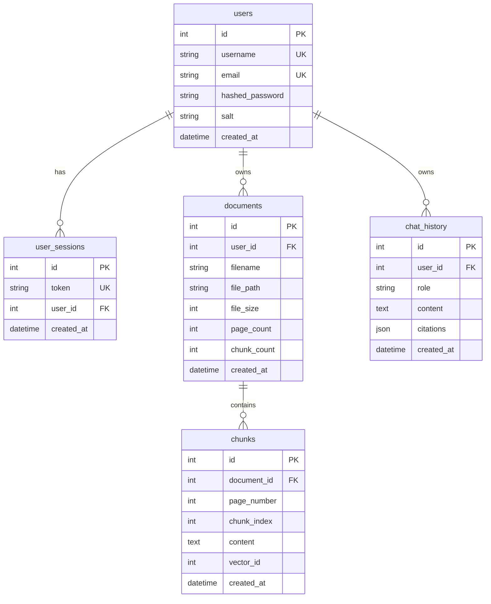

# AI Document Q&A System — Technical Architecture & Implementation Guide

---

## 1. Executive Summary & Overview

The **AI Document Q&A System** is an enterprise-grade, full-stack Retrieval-Augmented Generation (RAG) system engineered for high-precision question answering and multi-tenant document exploration. The system processes native text PDFs, scanned documents, receipts, bill photos, and handwritten notes. It grounds all responses using local vector similarity search and large language models (Google Gemini API), citing exact source document names and page numbers.

---

## 2. Complete Tech Stack

### Backend Framework & Core Libraries
| Component | Technology | Exact Version / Dependency | Purpose |
| :--- | :--- | :--- | :--- |
| **API Framework** | FastAPI | `fastapi>=0.110.0` | Asynchronous high-performance REST API routing and request validation |
| **ASGI Web Server** | Uvicorn | `uvicorn>=0.28.0` | Production ASGI web server running FastAPI |
| **Data Validation** | Pydantic v2 | `pydantic>=2.6.4`, `pydantic-settings>=2.2.1` | Strict schema validation and `.env` configuration management |
| **Authentication & Crypto** | PBKDF2-HMAC-SHA256 | Python `hashlib` & `secrets` | Zero-dependency, secure password hashing (100,000 iterations) and 64-char hex session tokens |

### Database & Persistence Tier
| Component | Technology | Exact Version / Dependency | Purpose |
| :--- | :--- | :--- | :--- |
| **ORM** | SQLAlchemy 2.0 | `sqlalchemy>=2.0.28` | Declarative mapping for Users, Sessions, Documents, Chunks, and Chat History |
| **Primary Relational DB**| PostgreSQL | `psycopg2-binary>=2.9.9` | Relational metadata store running in Docker Compose |
| **Fallback Relational DB**| SQLite 3 | Embedded (`rag.db`) | Automated zero-downtime fallback when PostgreSQL is unreachable |

### Document Parsing & Multimodal OCR
| Component | Technology | Exact Version / Dependency | Purpose |
| :--- | :--- | :--- | :--- |
| **Native PDF Parser** | PyMuPDF (`fitz`) | `pymupdf>=1.23.22` | High-speed page-by-page text extraction, coordinate tracking, and DPI rendering |
| **Image Handler** | Pillow (PIL) | Embedded with PyMuPDF | Image manipulation and byte streaming |
| **Multimodal Vision OCR**| Gemini Vision API | `google-genai>=0.1.1` | Zero-binary OCR for receipts, bills, handwritten notes, and scanned PDF pages |

### Embeddings & Vector Database
| Component | Technology | Exact Version / Dependency | Purpose |
| :--- | :--- | :--- | :--- |
| **Local Embedder** | BAAI/bge-m3 | `sentence-transformers>=2.5.1` | 1024-dimensional dense semantic vectors, running 100% locally on CPU/CUDA |
| **Vector Store** | FAISS CPU | `faiss-cpu>=1.8.0` | `IndexIDMap2(IndexFlatIP)` for exact cosine similarity search with persistent disk storage |
| **Array Math** | NumPy | `numpy>=1.26.4` | Vector normalization and array conversions |

### Large Language Model (Generation)
| Component | Technology | Exact Version / Dependency | Purpose |
| :--- | :--- | :--- | :--- |
| **LLM Provider** | Google Gemini API | `google-genai>=0.1.1` / `google-generativeai>=0.5.0` | Grounded answer generation, synthesis, and strict anti-hallucination guardrails |
| **Active Models** | Gemini Flash | Primary: `gemini-3.6-flash` / `gemini-3.5-flash`<br>Fallback: `gemini-3.5-flash-lite` | Multi-candidate resilience loop handling HTTP 503 high-demand spikes |

### Frontend Application
| Component | Technology | Exact Version / Dependency | Purpose |
| :--- | :--- | :--- | :--- |
| **UI Framework** | React 18 | `react^18.2.0`, `react-dom^18.2.0` | Component-based interactive user interface |
| **Build Tool & Bundler** | Vite 5 | `vite^5.1.6`, `@vitejs/plugin-react^4.2.1`| Hot-module replacement and production asset compilation |
| **Icons** | Lucide React | `lucide-react^0.359.0` | Modern, consistent SVG iconography |
| **Styling** | Custom CSS3 | Modern light palette (`#f8fafc`, `#ffffff`, `#4f46e5`) | Clean responsive UI, chat interface, and spreadsheet database explorer |

---

## 3. System Architecture & End-to-End Data Flow



---

## 4. Step-by-Step Data Pipeline

### Step 1: Upload & Ingestion (`POST /api/documents/upload`)
1. **Payload Receipt:** User uploads a file via the drag-and-drop zone (`App.jsx`). The client sends a multipart request with `Authorization: Bearer <token>`.
2. **Format Validation:** `documents.py` validates the extension against:
   ```python
   ALLOWED_EXTENSIONS = {".pdf", ".png", ".jpg", ".jpeg", ".webp"}
   ```
3. **Collision-Safe Persistence:** A unique UUID prefix is prepended (`<uuid8>_<sanitized_filename>`), and the file is written to the `uploads/` directory. Zero-byte uploads are immediately rejected.
4. **Multimodal Document Parsing (`document_parser.py`):**
   - **Text-Rich PDFs:** PyMuPDF (`fitz.open`) extracts native text per page (`page.get_text("text")`).
   - **Scanned / Hybrid PDFs:** If a page contains $<30$ characters, PyMuPDF renders a 150 DPI pixmap (`page.get_pixmap(dpi=150).tobytes("png")`) and sends it to Gemini Multimodal Vision for OCR.
   - **Direct Image Files:** `.png`, `.jpg`, `.jpeg`, and `.webp` files bypass PDF parsing and are directly transcribed by Gemini Multimodal Vision, preserving headers, line items, and tables.

### Step 2: Recursive Character & Sentence Chunking (`chunker.py`)
1. **Parameters:**
   - Target Chunk Size: `600 tokens` ($\approx 2,400$ characters)
   - Chunk Overlap: `100 tokens` ($\approx 400$ characters)
2. **Boundary Preservation:** The text is split across sentence terminators using lookahead regex:
   ```python
   re.split(r'(?<=[.?!])\s+', text)
   ```
3. **Sliding Window:** When a sentence exceeds the chunk limit, the chunk is committed, and an overlap window is calculated backwards from preceding sentences.
4. **Metadata Preservation:** Every chunk retains its `page_number`, `chunk_index`, and document ID for precise citations.

### Step 3: Local Vector Embedding & Dual Storage (`embedder.py` & `vector_store.py`)
1. **Local Dense Embedding:** Text chunks are sent in batches of 32 to `BAAI/bge-m3`. The output is converted to `np.float32` and L2-normalized:
   $$\|\mathbf{v}\|_2 = 1$$
2. **Relational Database Write:**
   - A `Document` record is inserted with `user_id`, `filename`, `file_size`, `page_count`, and `chunk_count`.
   - `Chunk` records are bulk-saved in the database with sequential integer primary keys (`vector_id`).
3. **Vector Store Write:**
   - Vectors and their matching `vector_id`s are added to FAISS using:
     ```python
     self.index.add_with_ids(vectors, id_array)
     ```
   - The updated FAISS index is saved to `faiss_index/index.faiss`.

### Step 4: Query Retrieval (`POST /api/chat`)
1. **Query Vectorization:** The user's query is normalized and encoded via `embedder.embed_query(query)`.
2. **Candidate Search in FAISS:**
   - FAISS searches a wider pool of candidate vectors (`search_k = max(top_k * 10, 60)`).
   - Because all vectors are L2-normalized, Inner Product search computes exact cosine similarity:
     $$\text{Cosine Similarity} = \mathbf{q} \cdot \mathbf{v}$$
3. **Multi-Tenant Database Hydration (`retriever.py`):**
   - The candidate vector IDs are filtered in PostgreSQL/SQLite:
     ```python
     db.query(Chunk, Document.filename)
       .join(Document, Chunk.document_id == Document.id)
       .filter(Chunk.vector_id.in_(vector_ids))
       .filter(Document.user_id == current_user.id)
     ```
   - If filtered to a specific file, `Chunk.document_id == document_id` is enforced.
   - Results are sorted by similarity score descending and sliced to `top_k = 5`.

### Step 5: Grounded Synthesis Prompt Template
Context chunks are formatted into numbered blocks:
```text
[Source 1: report.pdf, Page 4]
<extracted passage text>
```

Assembled into the grounded system prompt:
```text
You are a helpful, knowledgeable, and grounded AI assistant answering questions based on the provided document excerpts.

CRITICAL INSTRUCTIONS:
1. Base your answer strictly on the provided Context excerpts below. Do not fabricate facts, external links, or hallucinate citations.
2. For every factual statement and recommendation mentioned, cite the source document name and page number (e.g. [Document: report.pdf, Page 3]).
3. When answering synthesis, roadmap, or advisory questions:
   - Synthesize a helpful, well-structured answer from the subjects, chapters, and study materials present in the excerpts.
   - Highlight foundational topics first as listed in the resources, and cite the specific books, playlists, or tests provided.
4. Only if the provided context is completely unrelated to the user question, state:
"I cannot find relevant information in the provided document excerpts to answer this question."
5. Format your response cleanly using markdown.
```

### Step 6: Generation & UI Rendering
1. **Resilient Execution:** Dispatched to the Gemini API. If the primary model experiences a `503 UNAVAILABLE` high-demand spike, the system automatically cycles through fallback candidates:
   ```python
   models_to_try = [self.model_name, "gemini-3.5-flash", "gemini-3.5-flash-lite"]
   ```
2. **History Logging:** Both user question and assistant answer (including structured citations JSON) are committed to the `chat_history` table.
3. **Frontend Rendering:** The React client renders Markdown with syntax formatting, along with interactive citation badges showing document name, page number, and similarity score. Clicking a badge expands the exact retrieved text chunk.

---

## 5. Methodology & Key Functions Across Modules

### 1. [`backend/app/ingestion/document_parser.py`](file:///c:/Users/priya/health/RAG%20internship/backend/app/ingestion/document_parser.py)
- `parse_document(file_path, filename)`: Unified router dispatching to `_parse_pdf` or `_parse_image`.
- `_parse_pdf(file_path)`: Opens document with PyMuPDF, extracts text per page, checks character density threshold (`len >= 30`), and triggers 150 DPI pixmap rendering for image OCR if text is sparse.
- `_parse_image(file_path, filename)`: Reads binary image payload and calls Gemini Vision OCR.

### 2. [`backend/app/ingestion/chunker.py`](file:///c:/Users/priya/health/RAG%20internship/backend/app/ingestion/chunker.py)
- `_split_text(text)`: Implements character-approximated token chunking with sentence boundary preservation (`re.split`).
- `chunk_pages(pages)`: Iterates over extracted pages, generating chunk objects while maintaining `page_number` attribution.

### 3. [`backend/app/ingestion/embedder.py`](file:///c:/Users/priya/health/RAG%20internship/backend/app/ingestion/embedder.py)
- `_ensure_model_loaded()`: Thread-safe lazy loader ensuring `BAAI/bge-m3` only loads on first inference call.
- `embed_texts(texts, batch_size=32)`: Encodes chunk batches with L2 normalization (`normalize_embeddings=True`).
- `embed_query(query)`: Encodes single query string into normalized float32 vector.

### 4. [`backend/app/ingestion/vector_store.py`](file:///c:/Users/priya/health/RAG%20internship/backend/app/ingestion/vector_store.py)
- `_load_or_create_index()`: Loads existing `index.faiss` or creates new `faiss.IndexIDMap2(faiss.IndexFlatIP(1024))`.
- `add_vectors(vectors, ids)`: Thread-locked addition of vectors with explicit integer IDs.
- `remove_vectors(ids)`: Removes vector IDs when documents are deleted.
- `search(query_vector, top_k)`: Executes exact cosine similarity search.

### 5. [`backend/app/retrieval/retriever.py`](file:///c:/Users/priya/health/RAG%20internship/backend/app/retrieval/retriever.py)
- `retrieve_chunks(...)`: Queries FAISS for top 60 candidate vector IDs, then joins with database records filtered by `Document.user_id` and optional `document_id`.

### 6. [`backend/app/generation/llm_provider.py`](file:///c:/Users/priya/health/RAG%20internship/backend/app/generation/llm_provider.py)
- `generate_answer(query, context_chunks)`: Builds context prompts, applies anti-hallucination guardrails, and executes resilient model fallbacks.
- `extract_text_from_image(image_bytes, mime_type)`: Sends image buffers to Gemini Vision OCR.

### 7. [`backend/app/core/security.py`](file:///c:/Users/priya/health/RAG%20internship/backend/app/core/security.py)
- `hash_password(password, salt)`: PBKDF2-HMAC-SHA256 password hashing.
- `verify_password(password, hashed, salt)`: Constant-time digest verification using `secrets.compare_digest`.
- `get_current_user(authorization, db)`: FastAPI dependency verifying bearer session tokens.

### 8. [`backend/app/api/sheets.py`](file:///c:/Users/priya/health/RAG%20internship/backend/app/api/sheets.py)
- `get_sheets_summary()`: Computes total documents, chunks, pages, and storage usage.
- `get_documents_sheet()`: Formats documents into spreadsheet rows.
- `get_chunks_sheet()`: Returns paginated chunk rows with text search.
- `export_csv()`: Streams downloadable CSV spreadsheets of documents or chunks.

### 9. [`frontend/src/App.jsx`](file:///c:/Users/priya/health/RAG%20internship/frontend/src/App.jsx)
- Authentication state management (`token`, `user`) synced with `localStorage`.
- Navigation between `'chat'` (Chatbot) and `'sheet'` (Google Sheet Database Explorer).
- Drag-and-drop file upload handler supporting `.pdf`, `.png`, `.jpg`, `.jpeg`, `.webp`.
- Interactive chat interface with expandable citation snippets.
- Full spreadsheet grid with frozen headers, chunk search, cell inspection modal, and CSV export.

---

## 6. Key Technical Decisions & Justifications

| Technical Decision | Implementation | Rationale & Architectural Justification |
| :--- | :--- | :--- |
| **Local Embeddings** | `BAAI/bge-m3` (1024 dims) | **Free, Private & Top-Tier Accuracy:** Runs locally on CPU/CUDA with zero API costs, zero rate limits, and complete data privacy. Ranks at the top of Hugging Face MTEB benchmarks for RAG retrieval and multilingual dense representations. |
| **Chunking Parameters** | 600 tokens ($\approx 2,400$ chars)<br>100 tokens ($\approx 400$ chars) | **Optimal Semantic Density:** 600 tokens preserves complete paragraphs, code snippets, or exam problems without truncation, while keeping context focused. The 100-token overlap prevents splitting ideas across chunk boundaries. |
| **Vector Store Index** | FAISS `IndexIDMap2(IndexFlatIP)` | **Exact Cosine Similarity & ID Management:** By L2-normalizing vectors, Inner Product (`IndexFlatIP`) equals cosine similarity with zero approximation error. `IndexIDMap2` maps FAISS vectors directly to database primary keys, enabling clean deletions when documents are removed. |
| **Dual Database Strategy** | PostgreSQL + SQLite Fallback | **Production-Ready & Zero Friction:** Supports PostgreSQL in Docker Compose for production deployments, while automatically falling back to local SQLite (`rag.db`) if Postgres is not running. Allows instant local development without requiring Docker. |
| **Zero-Binary Multimodal OCR** | PyMuPDF Pixmap + Gemini Vision | **Eliminates C-Binary Dependencies:** Avoids external C binaries like Tesseract or Poppler (which often fail to install or configure on Windows). Gemini Vision delivers superior OCR accuracy on receipts, tables, and handwritten notes. |
| **Multi-Tenant Isolation** | SQL Join on `Document.user_id` | **Scalable Multi-Tenancy:** Avoids creating and maintaining separate FAISS index files for each user. A single unified FAISS index handles search, while the SQL retrieval query strictly enforces `Document.user_id == current_user.id`, preventing cross-user data leakage. |
| **Resilient Model Fallback** | Multi-candidate failover | **Prevents Free-Tier Failures:** When Google's `gemini-3.6-flash` experiences temporary `503 High Demand` spikes, the backend automatically fails over to `gemini-3.5-flash` or `gemini-3.5-flash-lite`, preventing dropped user requests. |

---

## 7. Relational Database Schema



---

## 8. Verification & Test Suite

The test suite contains **16 automated tests** covering security, ingestion, vector operations, and spreadsheet features:

```bash
python -m pytest backend/tests/ -v
```

### Verified Test Results:
- `test_api.py::test_health_endpoint` **PASSED**
- `test_api.py::test_upload_non_pdf_file` **PASSED**
- `test_api.py::test_upload_empty_pdf_file` **PASSED**
- `test_api.py::test_chat_without_documents` **PASSED**
- `test_api.py::test_chat_history_and_clear` **PASSED**
- `test_auth.py::test_signup_and_login_flow` **PASSED**
- `test_auth.py::test_multi_user_data_isolation` **PASSED**
- `test_chunker.py::test_chunker_preserves_page_numbers` **PASSED**
- `test_chunker.py::test_chunker_handles_long_text_with_overlap` **PASSED**
- `test_chunker.py::test_chunker_empty_and_whitespace` **PASSED**
- `test_document_parser.py::test_parse_text_pdf` **PASSED**
- `test_document_parser.py::test_parse_invalid_extension` **PASSED**
- `test_document_parser.py::test_parse_missing_file` **PASSED**
- `test_document_parser.py::test_parse_image_document` **PASSED**
- `test_retrieval.py::test_faiss_vector_store_operations` **PASSED**
- `test_sheets.py::test_sheets_endpoints_and_csv_export` **PASSED**

---

## 9. How to Run Locally

### Option A: Local Standalone (Fastest)

1. **Activate virtual environment:**
   ```bash
   # Windows PowerShell
   cd "backend"
   python -m uvicorn app.main:app --host 0.0.0.0 --port 8000
   ```
2. **Start Frontend:**
   ```bash
   cd "frontend"
   npm run dev
   ```
3. Open **[http://localhost:3000](http://localhost:3000)** in your browser.

### Option B: Docker Compose (Full Stack with PostgreSQL)

```bash
docker-compose up --build
```
- Frontend: `http://localhost:3000`
- Backend API: `http://localhost:8000`
- Interactive Swagger Docs: `http://localhost:8000/docs`
